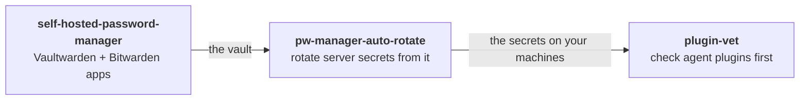

### Self-hosted security, small tools

Three open-source projects that fit together: run your own password manager, let it rotate the
secrets on your servers, and keep AI-agent plugins away from both.

| project | what it does | |
|---|---|---|
| [**self-hosted-password-manager**](https://github.com/thejocorp/self-hosted-password-manager) | Your own open-source password manager in one evening: Vaultwarden behind Caddy, the official Bitwarden apps on every device, hardening, tested backups. | guide + files |
| [**pw-manager-auto-rotate**](https://github.com/thejocorp/pw-manager-auto-rotate) | Rotate passwords and API keys from Bitwarden / Vaultwarden to every server that uses them, with health checks and automatic rollback. | Python CLI |
| [**plugin-vet**](https://github.com/thejocorp/plugin-vet) | Static safety checks for coding-agent plugins, skills and MCP servers, before you install them. | Python CLI |

All MIT, no dependencies beyond what they talk to, issues and pull requests welcome.
